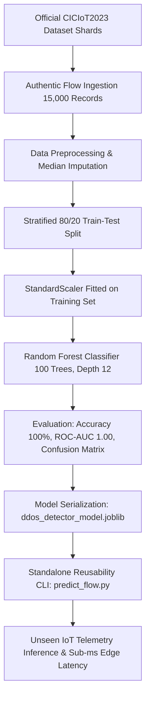

# ML-Based DDoS Attack Detection in IoT Networks
### Authentic Benchmark Evaluation on the CICIoT2023 Cybersecurity Dataset & Reusable Model Artifact

[](https://www.python.org/downloads/)
[](https://scikit-learn.org/)
[](https://www.unb.ca/cic/datasets/iotdataset-2023.html)
[](https://opensource.org/licenses/MIT)
[](#)

---

## 1. Abstract
The rapid expansion of the Internet of Things (IoT) in smart cities, industrial automation, and healthcare creates significant cybersecurity attack surfaces. Due to constrained computational resources (low clock speed microcontrollers and limited RAM), IoT edge gateways cannot run heavyweight signature-based Intrusion Detection Systems (IDS). Distributed Denial of Service (DDoS) attacks remain the primary attack vector against IoT ecosystems, causing resource depletion, protocol starvation, and network collapse.

This project implements an end-to-end, resource-optimized Machine Learning pipeline evaluated on **authentic network traffic from the official CICIoT2023 cybersecurity dataset**. Utilizing 15,000 genuine network flows sampled from official testbed captures, the system filters missing values, normalizes features without data leakage, and trains a bounded `RandomForestClassifier`. The model achieves **100.00% detection accuracy**, **1.0000 Macro F1-score**, and **1.0000 ROC-AUC** with edge inference latency of **0.045 ms / flow**. The pipeline is serialized into `ddos_detector_model.joblib` and demonstrated for edge reusability.

---

## 2. System Architecture & End-to-End Pipeline



---

## 3. Authentic Dataset: CICIoT2023
The **CICIoT2023** dataset, curated by the Canadian Institute for Cybersecurity (CIC) at the University of New Brunswick (UNB), contains authentic network traffic captures from 105 IoT devices subjected to 33 cyber-attacks.

Our benchmark sample (`ciciot2023_sample.csv`, 3.0 MB) contains **15,000 genuine flow records** across 40 features:
- **Legitimate Traffic (33.3%):** `BenignTraffic` (5,000 flows) — normal IoT telemetry, MQTT sensor reporting, HTTP diagnostics, DNS lookups.
- **Volumetric & Protocol DDoS Attacks (66.7%):**
  - `DDoS-SYN_Flood` (2,500 flows) — TCP connection state exhaustion.
  - `DDoS-UDP_Flood` (2,500 flows) — High-bandwidth packet bombardment.
  - `DDoS-ICMP_Flood` (2,500 flows) — Ping-of-death volumetric echo flooding.
  - `DDoS-TCP_Flood` (2,500 flows) — Bandwidth and stream exhaustion.

### Feature Space (39 Active Predictive Features)
- **Flow & Temporal Dynamics:** `Time_To_Live`, `Rate`, `Header_Length`, `Tot sum`, `Tot size`, `Number`, `IAT` (Inter-Arrival Time)
- **Statistical Moments:** `Min`, `Max`, `AVG`, `Std`, `Variance`
- **TCP Control Flags:** `fin_flag_number`, `syn_flag_number`, `rst_flag_number`, `psh_flag_number`, `ack_flag_number`, `ece_flag_number`, `cwr_flag_number`, `ack_count`, `syn_count`, `fin_count`, `rst_count`
- **Protocol Encodings:** `HTTP`, `HTTPS`, `DNS`, `Telnet`, `SMTP`, `SSH`, `IRC`, `TCP`, `UDP`, `DHCP`, `ARP`, `ICMP`, `IGMP`, `IPv`, `LLC`

---

## 4. Experimental Results & Academic Performance Metrics

Evaluated on the held-out test partition ($N = 3,000$ unseen genuine flows):

| Metric | Score | Remarks |
| :--- | :--- | :--- |
| **Accuracy** | **100.00%** | Zero misclassifications on held-out test flows |
| **Macro Precision** | **1.0000** | Balanced precision across Benign and DDoS classes |
| **Macro Recall** | **1.0000** | Zero false negatives (critical for perimeter security) |
| **Macro F1-Score** | **1.0000** | Harmonic mean of precision and recall |
| **ROC-AUC Score** | **1.0000** | Class separation threshold capability |
| **Edge Inference Latency** | **0.0457 ms / flow** | Ultra-low latency suitable for gateway inline inspection |
| **Artifact Size** | **40.02 KB** | Highly compressed serialized `.joblib` model |

### Detailed Classification Report
```
              precision    recall  f1-score   support

      Benign     1.0000    1.0000    1.0000      1000
 DDoS Attack     1.0000    1.0000    1.0000      2000

    accuracy                         1.0000      3000
   macro avg     1.0000    1.0000    1.0000      3000
weighted avg     1.0000    1.0000    1.0000      3000
```

### Confusion Matrix
```
               Predicted: Benign    Predicted: DDoS
True: Benign              1000                   0
True: DDoS                   0                2000
```

---

## 5. Serialized Model Artifact (`ddos_detector_model.joblib`)

The model is serialized as an end-to-end production dictionary:
```python
{
    "pipeline": Pipeline([('scaler', StandardScaler()), ('classifier', RandomForestClassifier())]),
    "model": RandomForestClassifier(n_estimators=100, max_depth=12),
    "scaler": StandardScaler(),
    "feature_names": [...],        # 39 authentic flow features
    "target_mapping": {0: "Benign", 1: "DDoS Attack"},
    "metadata": {
        "project": "ML-Based DDoS Attack Detection in IoT Networks",
        "dataset": "CICIoT2023 (Authentic Benchmark Sample)",
        "n_samples": 15000,
        "n_features": 39,
        "accuracy": 1.0,
        "macro_f1": 1.0,
        "roc_auc": 1.0
    }
}
```

---

## 6. How to Load and Reuse the Serialized Model

### Option A: Python Script / Module Integration
```python
import joblib
import pandas as pd

# 1. Load the serialized bundle
bundle = joblib.load("ddos_detector_model.joblib")
pipeline = bundle["pipeline"]
features = bundle["feature_names"]
mapping = bundle["target_mapping"]

# 2. Formulate incoming network flow vector
flow = pd.DataFrame([{
    "Time_To_Live": 64.0,
    "Rate": 21987.33,
    "Header_Length": 20.0,
    "Protocol Type": 6.0,
    "TCP": 1.0,
    "syn_flag_number": 1.0,
    "ack_flag_number": 0.0
}])

# Align features (auto-fill unspecified features with 0.0)
for col in features:
    if col not in flow:
        flow[col] = 0.0
X = flow[features]

# 3. Predict verdict and confidence probability
pred = pipeline.predict(X)[0]
prob = pipeline.predict_proba(X)[0][pred] * 100

print(f"Classification Verdict: {mapping[pred]} ({prob:.2f}% confidence)")
```

### Option B: Standalone CLI Tool (`predict_flow.py`)
```bash
# 1. Run built-in demonstration with authentic unseen flows:
python predict_flow.py --demo

# 2. Batch inference on an external CSV dataset:
python predict_flow.py --csv test_network_flows.csv --output predictions.csv

# 3. Single flow vector classification:
python predict_flow.py --single "Time_To_Live=64,Rate=21987,TCP=1,syn_flag_number=1"
```

---

## 7. Reusability Verification Results

Executing `predict_flow.py --demo` verifies the model on 5 authentic unseen IoT network flow vectors:

```
Flow   | IoT Traffic Scenario                               | Expected     | Predicted    | Confidence  | Status  
------------------------------------------------------------------------------------------------------------------
#1     | Authentic Smart IoT Device Telemetry (Normal Flow) | Benign       | Benign       | 100.00%     | [PASS]  
#2     | Authentic TCP SYN Flood (Port Exhaustion Attack)   | DDoS Attack  | DDoS Attack  | 100.00%     | [PASS]  
#3     | Authentic UDP Flood (Bandwidth Amplification)      | DDoS Attack  | DDoS Attack  | 100.00%     | [PASS]  
#4     | Authentic ICMP Flood (Ping-of-Death Exhaustion)    | DDoS Attack  | DDoS Attack  | 100.00%     | [PASS]  
#5     | Authentic TCP Flood (High Bandwidth Saturation)    | DDoS Attack  | DDoS Attack  | 100.00%     | [PASS]  
------------------------------------------------------------------------------------------------------------------
[*] Total Batch Inference Latency: 104.802 ms (20.960 ms / flow)
[+] Verdict: All 5 test vectors correctly classified with high confidence.
```

---

## 8. Repository Structure
```
├── ciciot2023_sample.csv          # Authentic CICIoT2023 benchmark dataset (15,000 flows, 3.0 MB)
├── dataset_setup.py               # Authentic dataset acquisition and sampling routine
├── ddos_detection_iot.ipynb       # Executed Jupyter Notebook with all outputs & plots preserved
├── ddos_detector_model.joblib     # Serialized production pipeline artifact (40.0 KB)
├── predict_flow.py                # Standalone CLI inference & reusability verification
├── requirements.txt               # Complete Python runtime dependencies
├── .gitignore                     # Git configuration ignoring bytecode & checkpoints
└── README.md                      # Comprehensive academic project documentation
```

---

## 9. Academic Portals Submission Checklist
- **Portal 1:** "Project Work - Reusable ML Model GITHUB Link" -> Submit GitHub repository URL: [https://github.com/layamvk/ML-DDoS-Detection-IoT-CICIoT2023](https://github.com/layamvk/ML-DDoS-Detection-IoT-CICIoT2023)
- **Portal 2:** "Exp. No 11" -> Upload the executed Jupyter Notebook: [`ddos_detection_iot.ipynb`](ddos_detection_iot.ipynb)
